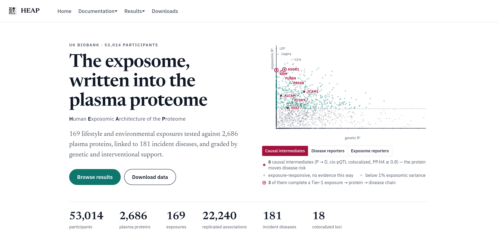

# HEAP: Human Exposomic Architecture of the Proteome

Analysis code for **"Human Plasma Proteomics Links Modifiable Lifestyle Exposome to Disease
Risk"** (Isaac *et al.*, in review).

[](https://heap.bio)

HEAP links lifestyle exposures, plasma proteins and disease risk in more than 50,000
UK Biobank participants (2,686 Olink proteins, 169 exposomic features).

**Just want the results?** Browse them at [heap.bio](https://heap.bio), or download the
paper's supplementary files directly (also listed on the
[heap.bio downloads page](https://heap.bio/downloads)). No code or data access is needed.

| File | Size | Contents |
|---|---|---|
| [Supplementary Tables](https://storage.googleapis.com/heap-data/supp/v1/HEAP_Supplementary_Tables.xlsx) (`.xlsx`) | 12.3 MB | 21 tables and an index sheet: variance decomposition and GREML, exposure–protein associations and their replication, tissue and pathway enrichment, GxE, mediation, MR motifs and triads, colocalization, intervention concordance, PES accuracy, and the exposure and disease lists |
| [Supplementary Data](https://storage.googleapis.com/heap-data/supp/v1/HEAP_Supplementary_Data.zip) (`.zip`) | 865 MB | Full results, organized by analysis and then by covariate specification: per-protein variance components, exposure and GxE associations, mediation, MR edges with confidence tiers, intervention concordance, PES scores and the deployable PES weights. A README and `manifest.tsv` inside describe every file |

## Quick start

```bash
git clone https://github.com/shakson-isaac/HEAP.git && cd HEAP
Rscript scripts/setup/install_r_packages.R                  # R 4.4.2 + 46 packages
bash demo/run_demo.sh                                       # synthetic data, one core
```

The demo runs the real analysis code, in the paper's order (variance decomposition with
HEAP R² and GREML, exposure–protein associations, mediation, Mendelian randomization from
GWAS summary statistics, exposure scores) on constructed synthetic data, not real
participant data, to check that the code runs and to show the input formats. See
[`demo/README.md`](demo/README.md). The demo takes about 14 minutes on one core with
1.5 GB of memory.

To run the full analysis you need an approved
[UK Biobank application](https://www.ukbiobank.ac.uk/enable-your-research/apply-for-access)
(the data cannot be redistributed). Follow
[`docs/REPRODUCIBILITY.md`](docs/REPRODUCIBILITY.md).

## Repository

```
demo/      Synthetic-data demo
scripts/   Analysis code, one directory per analysis; visualizations/ draws every figure
config/    Every analysis setting (covariate sets, sample filters, exposure and protein
           sets, experiments). Scripts hardcode none.
slurm/     Job scripts for a SLURM cluster
workflow/  Path configuration and config validation
docs/      Run guide, software environment, data sources
```

## Figures and code

| Figure | Analysis | Code |
|---|---|---|
| Fig. 1 | Genetic vs. exposomic variance of each protein | [`scripts/module1_variance_decomposition`](scripts/module1_variance_decomposition) |
| Fig. 2 | Exposure–protein associations | [`scripts/module2_associations`](scripts/module2_associations) |
| Fig. 3 | Mediation of exposure → disease through proteins | [`scripts/module3_mediation`](scripts/module3_mediation) |
| Fig. 4 | Mendelian randomization and colocalization | [`scripts/module5_mr`](scripts/module5_mr) |
| Fig. 5 | Comparison with intervention trials | [`scripts/support/intervention_compare`](scripts/support/intervention_compare) |
| Fig. 6 | Proteome-based exposure scores (PES) | [`scripts/module6_prediction`](scripts/module6_prediction) |
| Fig. 2b, supplementary | Tissue and pathway enrichment | [`scripts/module4_enrichment`](scripts/module4_enrichment) |

Code directory numbers reflect the order the analyses were written, not the figure order. Supporting steps:
[`loaders`](scripts/loaders) (builds the analysis dataset),
[`genetic_scores`](scripts/genetic_scores), [`gwas_regenie`](scripts/gwas_regenie),
[`ldsc`](scripts/ldsc) and [`population_architecture`](scripts/population_architecture) (GREML).

## Documentation

| | |
|---|---|
| [`docs/REPRODUCIBILITY.md`](docs/REPRODUCIBILITY.md) | Analysis dataset structure, run order, commands, runtimes, Supplementary Table sources |
| [`docs/ENVIRONMENT.md`](docs/ENVIRONMENT.md) | Software versions, OS, hardware, environment variables |
| [`docs/DATA_ACCESS.md`](docs/DATA_ACCESS.md) | Data sources |
| [`scripts/visualizations/README.md`](scripts/visualizations/README.md) | Which script draws each figure panel |
| The paper's Methods and Supplementary Notes | Why each method was chosen |

## Citation

Isaac S, Ellis RJ, Jee YH, Murthy VL, Udler MS, Neale BM, Sunyaev S, Gusev A,
Martin AR, Patel CJ. *Human Plasma Proteomics Links Modifiable Lifestyle Exposome to
Disease Risk.* In review.

## License and contact

Code: [MIT License](LICENSE). UK Biobank data are subject to UK Biobank's access
conditions. Questions: shakson_isaac@g.harvard.edu or
[GitHub issues](https://github.com/shakson-isaac/HEAP/issues).
